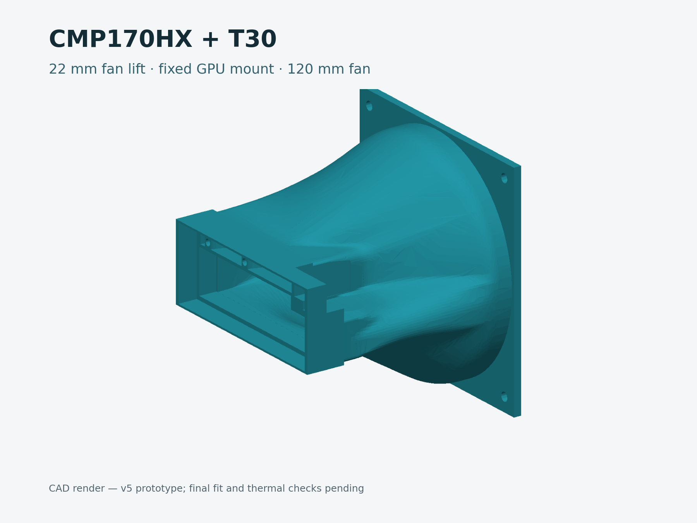
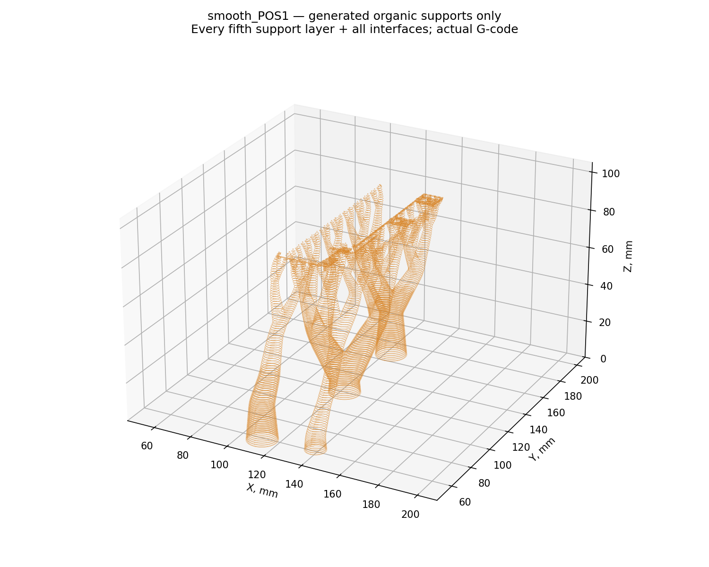
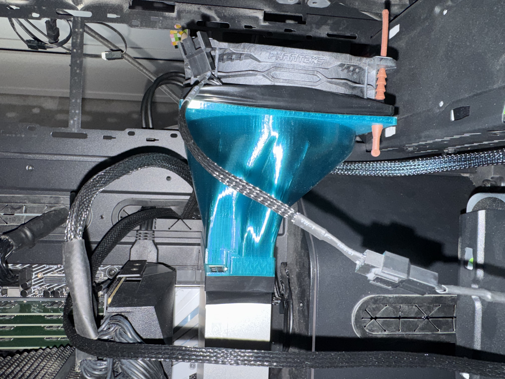

# CMP170HX — Phanteks T30 fan duct

A smooth fan adapter for the measured NVIDIA CMP170HX end interface. **v5 raises the 120 mm fan by 22 mm** relative to the earlier printed v4 while retaining the GPU attachment and axial length, to address an HDD-bay clash in the project build.

**Prototype:** v4 was printed and fitted. v5 was sliced and sent to the printer; final print quality, HDD clearance and operating temperatures have not yet been confirmed. No v5 CFD or cooling improvement is claimed.

[Download files](https://github.com/aotd1/cmp170hx-t30-duct/releases) · [MakerWorld draft (owner access)](https://makerworld.com/en/my/models/drafts/10616681/edit) · [Assembly guide](docs/ASSEMBLY.md)

## Files

- [Print-oriented STL](models/v5-raised22/print-orientation.stl) — fan flange on the build plate.
- [Assembly-coordinate STL](models/v5-raised22/assembly.stl).
- [Editable P1S / PETG 3MF](profiles/p1s/v5-raised22-p1s-petg.3mf) — reslice and map your own filament slot before printing.
- [Build source](src/v5/build_body.py), [dimensions](src/v5/design-parameters.json) and [build guide](docs/BUILD.md).

## Print setup

P1S, 0.4 mm nozzle, PETG, 0.2 mm layers, 3 wall loops, 20% gyroid, 5 top/bottom layers. Tree supports from the build plate, 0.2 mm top Z gap and 3 interface layers. Trial filament: NIT PETG transparent light blue, 250 °C nozzle / 75 °C bed. Adapt temperatures to your filament.

Slicer estimate: **5 h 22 min / 102.88 g**, including supports; 520 layers. Print envelope: **120 × 120 × 104 mm**. These are estimates from the original local slice. The package contains an editable project, not machine-specific ready-to-run G-code.

[Support layer views](assets/gallery/support-layers.png) · [Print orientation](assets/gallery/print-orientation.png)

## Fit and assembly

Card end measured at 98 × 38.5 mm; main opening 94.3 × 23.65 mm, narrowing to 92.5 mm at 6 mm depth. GPU screw pitch: 28.5 mm, subject to measurement uncertainty. Fan holes: 105 mm square pitch, 4.8 mm diameter; circular airway: 113 mm.

Adapter extends approximately 94 mm from the card end; with a 30 mm T30, allow about **124 mm** before additional cable/assembly clearance. "Raised 22 mm" describes the change from v4, not the position relative to the GPU center.

Use two suitably sized GPU screws and four fan mounts compatible with the 4 mm plate. Screw length/thread engagement must be checked on the actual card. Support the fan end independently, avoid overtightening the narrow GPU lands, and check the EPS connector and cable bend before loading the GPU. The **fan outlet side (label and support struts) faces the duct/card**.

[Detailed installation and checks](docs/ASSEMBLY.md)

## Evidence and limits

The photograph above shows **v4 before the 22 mm lift**, documenting the installation that motivated v5. [CAD comparison](assets/gallery/v4-v5-comparison.png) shows both geometries. [Validation records](validation/) cover closed mesh, preserved interface and slicing, not a thermal or structural certification. PETG creep and final chassis clearance require physical checks; other CMP170HX revisions and A100 cards are unverified.

## Source and license

Remix of [K. Crisafulli / kelleec's adapter](https://www.thingiverse.com/thing:7411932), based on V1.40 POS1. **[CC BY-SA 4.0](LICENSE.md)** permits personal and commercial use, with attribution and share-alike conditions. [Changes and attribution](ATTRIBUTION.md).
