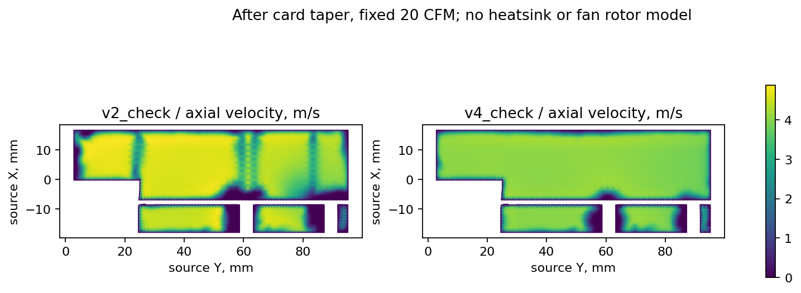
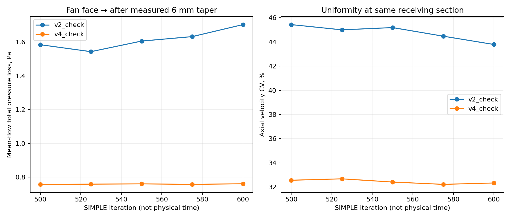

# Airflow development: preliminary v2 / v4 comparison

**These results compare two earlier development prototypes, v2 and v4. They are not a simulation of the published v5 and do not compare v5 directly with the Thingiverse original.** v5 later moved the fan/collar by 22 mm and rebuilt the transition; that geometry has not been simulated again.

The earlier comparison indicated lower flow resistance and a more even distribution into the card entrance after the combined changes to the windows, splitter and transition. It does not isolate the contribution of any one feature.

## Results at the same imposed flow

Both cases use **20 CFM (about 34 m³/h)**. Values below are sampled at the final, 600th solver iteration. The card-entry section includes the measured 6 mm narrowing, followed by an ideal empty receiver.

| Result | Earlier v2 | Revised v4 |
|---|---:|---:|
| Total pressure loss through duct and short card entry | 1.704 Pa | 0.761 Pa |
| Variation in forward velocity across the sampled entry (CV) | 43.79% | 32.34% |
| Area with reverse flow | 5.35% | 2.00% |
| Sideways velocity, RMS | 0.402 m/s | 0.243 m/s |
| Total pressure loss in the printed duct alone | 1.184 Pa | 0.584 Pa |

At this iteration, the pressure-loss reduction including the card entry is about **55%**. The velocity CV falls by about **26% relative to v2** (11.45 percentage points). The smaller reverse-flow area indicates fewer regions where air moves against the intended direction. The imposed flow is the same in both cases; this is not evidence of 55% more airflow from a real T30.

The same colour scale is used in both maps. A more even forward-speed distribution is visible in v4. The colour maps are sections of a flow-only simulation, not thermal images or measurements of the printed part.

## Why these are preliminary results

- The steady incompressible SST RANS calculation ran for 600 SIMPLE iterations; strict residual convergence was **not** reached for either case.
- Over the last 100 sampled iterations, pressure loss including the entry varied from **1.544–1.704 Pa for v2** and **0.758–0.761 Pa for v4**. The final percentage is not a convergence-certified measurement.
- Velocity CV over the same samples ranged from 43.79–45.43% for v2 and 32.22–32.68% for v4. Iteration ranges are not statistical confidence intervals or physical time averages.
- The meshes contain approximately 833,000 and 848,000 cells. Mesh checks report concave polyhedra and a common skewed boundary face. No matched grid-convergence study or prism-layer mesh was completed.
- Interpolated flow at the sampled section differs from the imposed flow by about −3.03% and −3.37%. Conservative face-flux mass balance is a separate check and does not remove this sampling limitation.
- The fan rotor, hub, swirl, heatsink fins, complete card resistance, heat transfer, leakage and case surroundings were excluded. No fan operating point, GPU temperature, noise reduction or long-term cooling result is predicted.

## Evidence

[Full numerical comparison](../validation/airflow-v2-v4/COMPARISON.json) · [Paired numerical setup checks](../validation/airflow-v2-v4/paired-numerics-validation.json)

The paired checks confirm identical discretization, relaxation, fluid properties, turbulence model and physical boundary specifications; mapped initial values differ between meshes. The v4-wall2 print keeps the same air volume as v4. This equivalence does not extend to the raised-fan v5.
